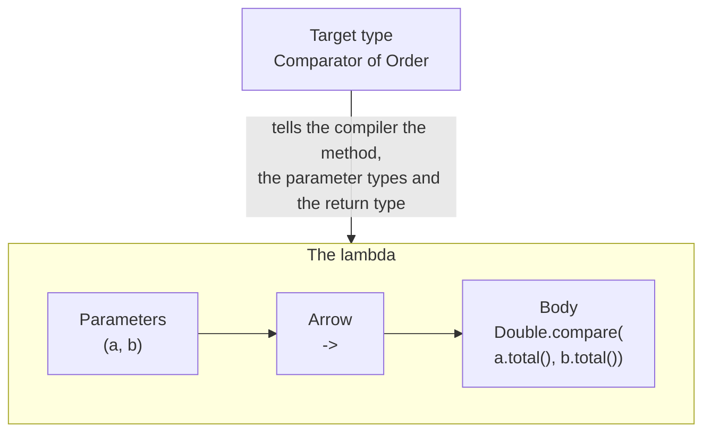
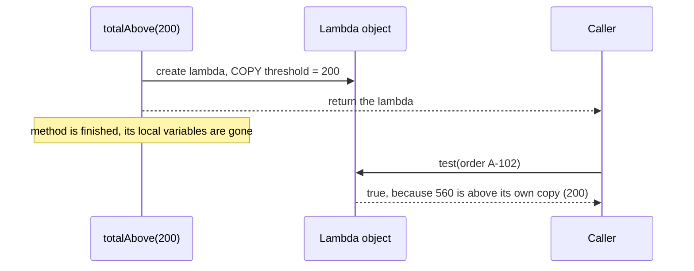
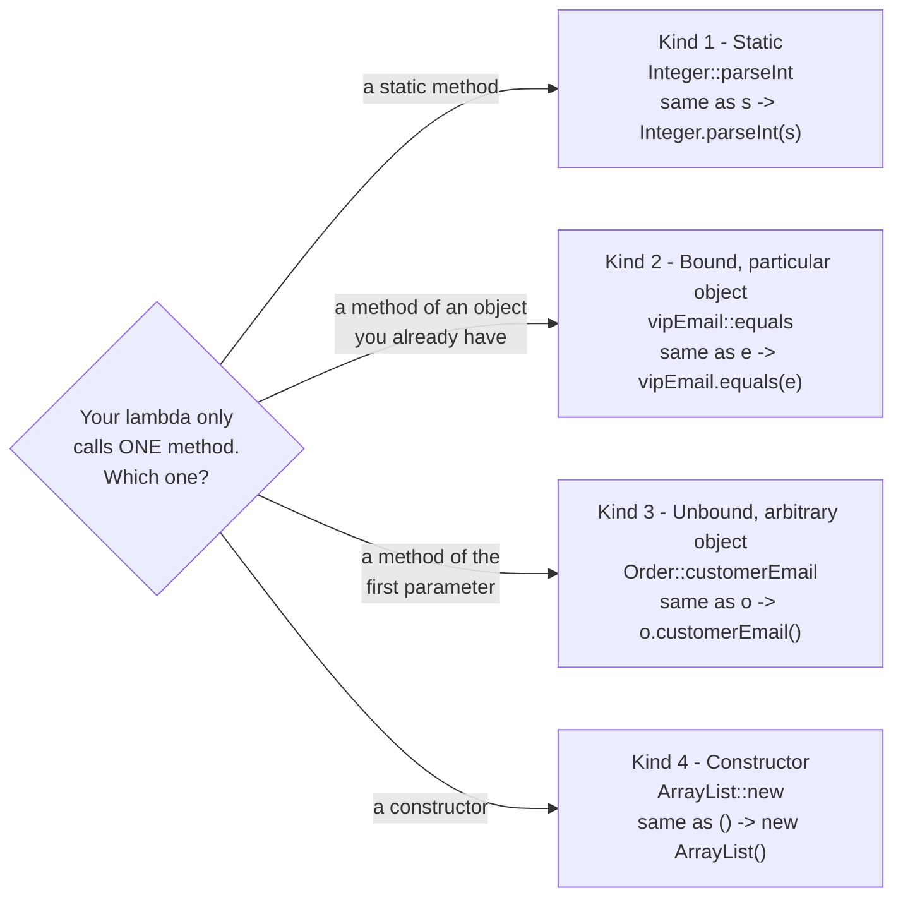

# 1. Lambda Expressions

> **In one sentence:** a lambda is a short way to write *"the body of one method"* as a value, so you can pass behaviour around like you pass data.

Demo code: `src/main/java/com/training/demo/lambdas/demo/`
Exercises: `src/main/java/com/training/demo/lambdas/exercises/` (tests in `src/test/java/...`)

---

## 1.1 Why lambdas exist: before and after

Our order service must sort orders by total. `List.sort(...)` needs a `Comparator`: an object with one method, `compare(a, b)`.

**Before (Java 7 style): anonymous inner class**

```java
Comparator<Order> byTotal = new Comparator<Order>() {
    @Override
    public int compare(Order a, Order b) {
        return Double.compare(a.total(), b.total());
    }
};
orders.sort(byTotal);
```

Six lines, and only one of them (`Double.compare(...)`) is the real logic. The rest is ceremony.

**After (Java 8+): lambda**

```java
Comparator<Order> byTotal = (a, b) -> Double.compare(a.total(), b.total());
orders.sort(byTotal);
```

The compiler already knows the target type is `Comparator<Order>`, so it can work out:

- which method we are writing (`compare`, the only abstract one)
- the parameter types (`a` and `b` are `Order`)
- the return type (`int`)

Run: `Demo01_AnonymousClassVsLambda`

---

## 1.2 Anatomy of a lambda



| Form | Example | When |
|---|---|---|
| Full | `(Order o) -> { return o.total() > 100; }` | Always legal |
| Inferred types | `(o) -> { return o.total() > 100; }` | Compiler knows the type from the target |
| One parameter, no parentheses | `o -> { return o.total() > 100; }` | Exactly one parameter, no type written |
| One expression, no braces | `o -> o.total() > 100` | Body is a single expression: no braces, no `return`, no `;` |
| No parameters | `() -> "Welcome"` | Empty `()` is required |
| Two or more parameters | `(total, shipping) -> total + shipping` | Parentheses are required |
| Block body | `o -> { String k = ...; return k; }` | More than one statement: braces and `return` required |

Run: `Demo02_LambdaSyntax`

---

## 1.3 Capturing variables: "effectively final"

A lambda can use local variables of the method around it:

```java
static Predicate<Order> totalAbove(double threshold) {
    return o -> o.total() > threshold;   // uses threshold
}
```

The rule: the variable must be **final or effectively final**, meaning it is never changed after it gets its value. (Test: if you could add the word `final` and it still compiles, it is effectively final.)

**Why does Java insist on this?**

1. A lambda can run **later**: `totalAbove(200)` returns, its local variable `threshold` is gone, but the predicate is still used afterwards.
2. A lambda can run **on another thread**.
3. So Java **copies the value** into the lambda object when the lambda is created.
4. If you were allowed to change the original variable afterwards, the copy inside the lambda and the original would **silently disagree**. Java prevents this bug by refusing to compile.



What you get if you break the rule (real output of `javac --release 17`, file `broken-examples/01-captured-variable-changed/Counter.java`):

```java
int count = 0;
count++;
return () -> count;
```

```text
Counter.java:6: error: local variables referenced from a lambda expression must be final or effectively final
        return () -> count;
                     ^
1 error
```

Run: `Demo03_EffectivelyFinal`

---

## 1.4 The loop-variable trap

```java
for (int i = 0; i < orders.size(); i++) {
    jobs.add(() -> System.out.println(i));   // does NOT compile
}
```

There is only **one** variable `i`, and `i++` changes it every round. The jobs run after the loop, when `i` is already `3`. Real `javac` output (`broken-examples/02-loop-variable/Loop.java`):

```text
Loop.java:6: error: local variables referenced from a lambda expression must be final or effectively final
            tasks.add(() -> System.out.println(i));
                                               ^
1 error
```

**Fix 1:** copy into a new local variable inside the loop body. It is a fresh variable every round, and never changes.

```java
for (int i = 0; i < orders.size(); i++) {
    int position = i;
    jobs.add(() -> System.out.println("job " + position));
}
```

**Fix 2:** use the enhanced for loop. Its variable is fresh in every round.

```java
for (Order order : orders) {
    jobs.add(() -> System.out.println(order.id()));
}
```

Run: `Demo04_LoopVariableTrap`

---

## 1.5 Method references

If a lambda does nothing except call one existing method, you can replace it with a **method reference** (`::`).



| Kind | Syntax | Example | Equivalent lambda |
|---|---|---|---|
| Static | `ClassName::staticMethod` | `Integer::parseInt` | `s -> Integer.parseInt(s)` |
| Bound (particular object) | `object::method` | `System.out::println` | `x -> System.out.println(x)` |
| Unbound (arbitrary object of a type) | `ClassName::instanceMethod` | `Order::customerEmail` | `o -> o.customerEmail()` |
| Constructor | `ClassName::new` | `ArrayList::new` | `() -> new ArrayList<>()` |

**Bound vs unbound** is the part interns mix up:

- **Bound:** the object is fixed *when you create the reference*. `vipEmail::equals` always compares against that one `vipEmail`.
- **Unbound:** the object arrives *as the first argument* each time. `Order::customerEmail` works on whichever order it is given. `String::startsWith` as a `BiFunction<String, String, Boolean>` means `(s, prefix) -> s.startsWith(prefix)`.

Run: `Demo05_MethodReferences`

---

## 1.6 Common Mistakes

**1. Changing a captured variable.** Counting with `count++` inside `forEach` does not compile. Let the library do the work instead: `orders.stream().filter(Order::isPaid).count()` (topic 3).

**2. Forgetting the loop variable is not effectively final.** Copy it into a local inside the loop, or use for-each.

**3. Fat lambdas.** A lambda with 10 lines of business rules has no name, cannot be unit tested on its own, and shows up as a generated name like `lambda$main$0` in stack traces.

```java
// BAD
Predicate<Order> freeShipping = o -> {
    if (o.status() == OrderStatus.CANCELLED) return false;
    if (o.skus().isEmpty()) return false;
    if (o.premium()) return true;
    return o.total() >= 50;
};

// GOOD: a named, documented, testable method + a method reference
Predicate<Order> freeShipping = Demo06_CommonMistakes::qualifiesForFreeShipping;
```

Rule of thumb: if the lambda body needs braces and more than two or three lines, extract a method.

**4. Thinking `this` inside a lambda means the lambda.** Inside an anonymous class `this` is the anonymous object. Inside a lambda `this` is the object of the *surrounding* class. A lambda does not create a new scope for `this`.

Run: `Demo06_CommonMistakes`

---

## 1.7 Exercises (do them together)

| # | Class | Level | Idea |
|---|---|---|---|
| 1 | `Ex01_SortByTotal` | easy | first lambda: a `Comparator` |
| 2 | `Ex02_CaptureThreshold` | easy/medium | lambdas that capture parameters |
| 3 | `Ex03_MethodReferences` | medium | one method reference of each kind |
| 4 | `Ex04_DelayedLabels` | hard | the loop-variable trap in a real task |

Run one: `mvn test -Dtest=Ex01_SortByTotalTest`

Next: [2. Functional Interfaces](02-functional-interfaces.md)
