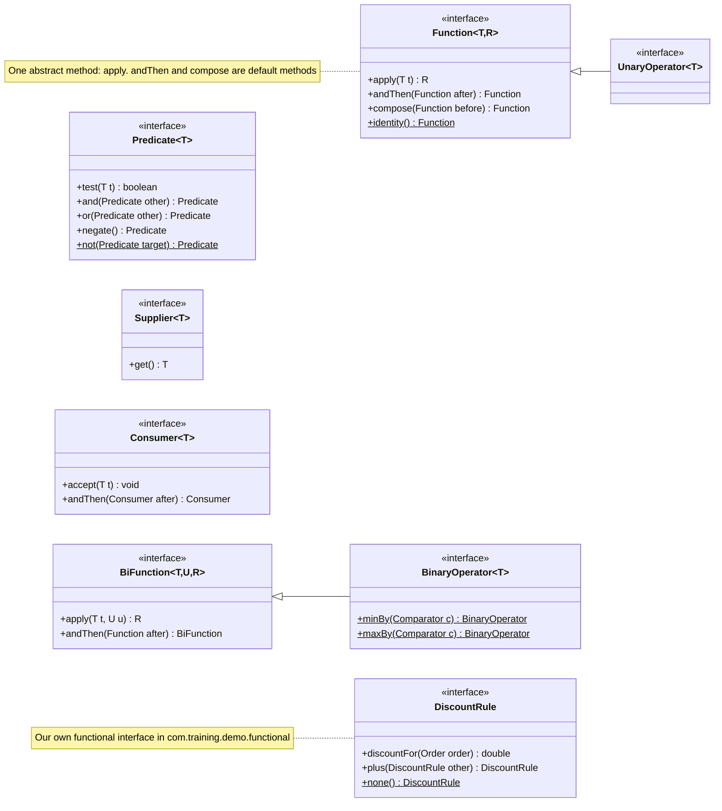
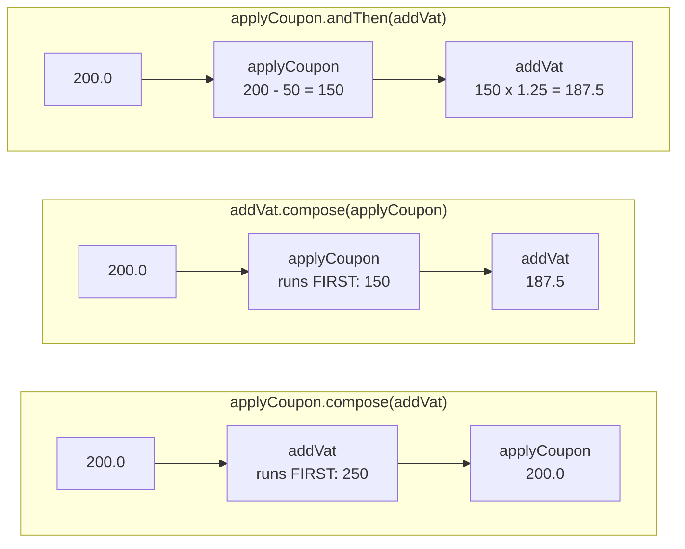

# 2. Functional Interfaces

> **In one sentence:** a functional interface is an interface with exactly **one abstract method**; it is the *type* of a lambda.

Demo code: `src/main/java/com/training/demo/functional/demo/`
Our own interface: `src/main/java/com/training/demo/functional/DiscountRule.java`
Broken examples for live compiling: `broken-examples/03-*`, `04-*`, `05-*`

---

## 2.1 Why they exist

A lambda on its own has no type. `o -> o.total() > 100` could be many things. Java needs a **target type** to know:

- which method the lambda implements
- what the parameter types are
- what it must return

Instead of adding a brand-new "function type" to the language, Java 8 reused something everyone already knew: **interfaces**. Any interface with exactly one abstract method can be the target of a lambda. `Comparator`, `Runnable` and `Callable` existed long before Java 8 and they all work with lambdas.

**Before:** every time you wanted to pass behaviour you wrote an interface *and* an (anonymous) class.
**After:** you use a ready-made interface from `java.util.function` and write a lambda.

---

## 2.2 What counts as "one abstract method"

| Method in the interface | Counts toward the one? | Why |
|---|---|---|
| `boolean check(Order o);` | **Yes** | abstract, no body |
| `default String describe(Order o) { ... }` | No | has a body |
| `static OrderCheck alwaysOk() { ... }` | No | belongs to the interface, not to objects |
| `String toString();` / `boolean equals(Object o);` | No | every object already has these from `Object` |

```java
@FunctionalInterface
interface OrderCheck {
    boolean check(Order order);                       // THE abstract method
    default String describe(Order order) { ... }      // does not count
    static OrderCheck alwaysOk() { return o -> true; } // does not count
    @Override String toString();                      // does not count
}

OrderCheck notCancelled = order -> order.status() != OrderStatus.CANCELLED;
```

Run: `Demo01_WhatMakesItFunctional`

---

## 2.3 `@FunctionalInterface`: what happens when you break the rule

The annotation is **optional**. It does not change how the interface works; it asks the compiler to *check* the rule and fail early. All messages below are real `javac --release 17` output from the files in `broken-examples/`.

**Two abstract methods, WITH the annotation** (`broken-examples/03-annotated-two-abstract-methods/OrderRule.java`):

```java
@FunctionalInterface
public interface OrderRule {
    boolean test(String orderId);
    String describe();
}
```

```text
OrderRule.java:1: error: Unexpected @FunctionalInterface annotation
@FunctionalInterface
^
  OrderRule is not a functional interface
    multiple non-overriding abstract methods found in interface OrderRule
1 error
```

The error points at the **interface**, the moment someone adds the second method.

**Two abstract methods, WITHOUT the annotation** (`broken-examples/04-not-annotated-two-abstract-methods/`): `OrderRule.java` on its own compiles fine. The error only appears where someone tries to use a lambda:

```java
OrderRule rule = id -> id.startsWith("A");
```

```text
UseRule.java:2: error: incompatible types: OrderRule is not a functional interface
    OrderRule rule = id -> id.startsWith("A");
                     ^
    multiple non-overriding abstract methods found in interface OrderRule
1 error
```

So without the annotation, the mistake shows up somewhere else, possibly in another team's code.

**Zero abstract methods, WITH the annotation** (`broken-examples/05-annotated-no-abstract-method/Empty.java`):

```text
Empty.java:1: error: Unexpected @FunctionalInterface annotation
@FunctionalInterface
^
  Empty is not a functional interface
    no abstract method found in interface Empty
1 error
```

Compile any of them live from the project root, for example:

```text
javac --release 17 -d target/broken broken-examples/03-annotated-two-abstract-methods/*.java
```

---

## 2.4 The core types in `java.util.function`

Pick by the **shape**: what goes in, what comes out.

| Interface | Shape | Method | Reach for it when... |
|---|---|---|---|
| `Function<T, R>` | `T -> R` | `apply` | you convert one thing into another (Order to email) |
| `BiFunction<T, U, R>` | `(T, U) -> R` | `apply` | you need two inputs to compute a result (order + tax rate to price) |
| `Supplier<T>` | `() -> T` | `get` | you produce a value on demand (new id, default value, lazy creation) |
| `Consumer<T>` | `T -> void` | `accept` | you do something with a value and return nothing (log, save, print) |
| `BiConsumer<T, U>` | `(T, U) -> void` | `accept` | the same with two inputs (order + message to send a mail) |
| `Predicate<T>` | `T -> boolean` | `test` | you ask a yes/no question (is it paid?) |
| `BiPredicate<T, U>` | `(T, U) -> boolean` | `test` | a yes/no question about two values (does order contain SKU?) |
| `UnaryOperator<T>` | `T -> T` | `apply` | input and output are the same type (normalise a String) |
| `BinaryOperator<T>` | `(T, T) -> T` | `apply` | you combine two of the same into one (sum, max) |

There are also primitive versions such as `IntPredicate` and `ToDoubleFunction<T>` that avoid boxing `int` to `Integer`.



(Underlined methods are `static`. Every other non-abstract method is a `default` method.)

Run: `Demo02_CoreFunctionalTypes`

---

## 2.5 Writing your own functional interface

Use the built-in types first. Write your own when a **domain name** makes the code clearer or you want domain helper methods.

```java
@FunctionalInterface
public interface DiscountRule {
    double discountFor(Order order);                  // the one abstract method

    default DiscountRule plus(DiscountRule other) {   // combine rules
        return order -> this.discountFor(order) + other.discountFor(order);
    }

    static DiscountRule none() {                      // a "no discount" rule
        return order -> 0.0;
    }
}

DiscountRule premiumTenPercent = order -> order.premium() ? order.total() * 0.10 : 0.0;
DiscountRule bigOrderFlat20   = order -> order.total() >= 500 ? 20.0 : 0.0;
DiscountRule blackFriday      = premiumTenPercent.plus(bigOrderFlat20);
```

`DiscountRule` vs `Function<Order, Double>`: the name says what it is for, `discountFor(...)` reads well, it returns a primitive `double` (no boxing), and it can carry `plus` and `none`.

Run: `Demo03_CustomFunctionalInterface` (A-102: 56.00 + 20.00 = 76.00 discount)

---

## 2.6 Default and static helper methods: composing behaviour

| Method | On | Meaning |
|---|---|---|
| `f.andThen(g)` | `Function` | run `f`, then feed its result into `g` |
| `f.compose(g)` | `Function` | run `g` first, then `f`. Read it as "f of g" |
| `Function.identity()` | `Function` (static) | returns its input unchanged |
| `p.and(q)` | `Predicate` | both must be true (stops early if `p` is false) |
| `p.or(q)` | `Predicate` | at least one must be true (stops early if `p` is true) |
| `p.negate()` | `Predicate` | flips true and false |
| `Predicate.not(p)` | `Predicate` (static, Java 11+) | same as `p.negate()`, reads well inside `filter(...)` |

**Order matters.** A 50 EUR coupon and 25% VAT on a 200 EUR order:

```java
Function<Double, Double> applyCoupon = price -> price - 50;
Function<Double, Double> addVat      = price -> price * 1.25;

applyCoupon.andThen(addVat).apply(200.0);   // 187.5  coupon first
addVat.compose(applyCoupon).apply(200.0);   // 187.5  coupon first (the argument runs first)
applyCoupon.compose(addVat).apply(200.0);   // 200.0  VAT first
```



Predicates combine the same way:

```java
Predicate<Order> isPaid    = o -> o.status() == OrderStatus.PAID;
Predicate<Order> isPremium = Order::premium;

isPaid.and(isPremium)      // [A-100, A-105]
isPaid.or(isPremium)       // [A-100, A-102, A-103, A-105]
isPremium.negate()         // [A-101, A-103, A-104, A-106]
Predicate.not(isCancelled) // every order except A-104
```

Run: `Demo04_ComposingFunctions` (each step prints, so you can see the execution order)

---

## 2.7 Common Mistakes

**1. Adding a second abstract method to an interface that is used with lambdas.** Every lambda for it stops compiling. Put `@FunctionalInterface` on interfaces meant for lambdas, so the error appears in the interface itself.

**2. Thinking `@FunctionalInterface` is required.** It is not. Any interface with exactly one abstract method works with lambdas, with or without the annotation. The annotation is only a safety check.

**3. Mixing up `andThen` and `compose`.** `f.andThen(g)` = f first. `f.compose(g)` = g first. When in doubt use `andThen`: it reads left to right.

**4. Writing your own interface when a built-in one fits.** `interface OrderFilter { boolean matches(Order o); }` is just `Predicate<Order>`, and you lose `and`, `or`, `negate`.

**5. Boxing in hot loops.** `Function<Integer, Integer>` boxes every value. For large numeric work prefer `IntUnaryOperator`, `ToDoubleFunction<T>` and friends.

---

## 2.8 Exercises (do them together)

| # | Class | Level | Idea |
|---|---|---|---|
| 1 | `Ex01_CoreTypes` | easy | a lambda for `Predicate`, `Function`, `BiPredicate`, `BinaryOperator` |
| 2 | `Ex02_CustomDiscountRules` | medium | implement and combine `DiscountRule` |
| 3 | `Ex03_CombinePredicates` | medium | `and`, `or`, `negate`, `Predicate.not` |
| 4 | `Ex04_PricePipeline` | hard | `andThen`, `compose`, `Function.identity()` in the right order |

Run one: `mvn test -Dtest=Ex03_CombinePredicatesTest`

Previous: [1. Lambdas](01-lambdas.md) | Next: [3. Streams](03-streams.md)
