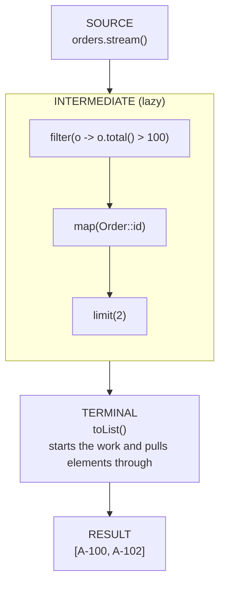
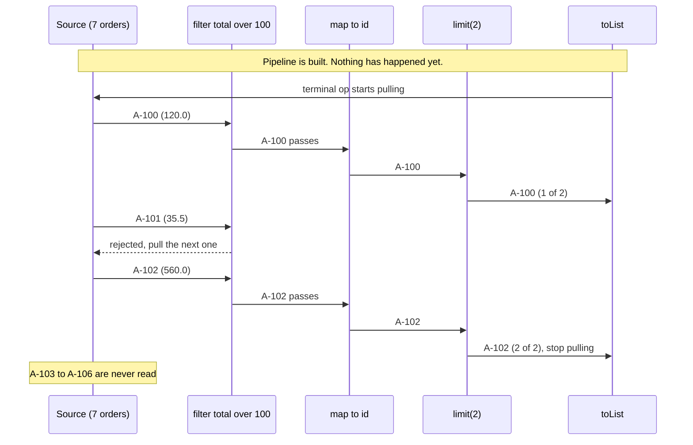
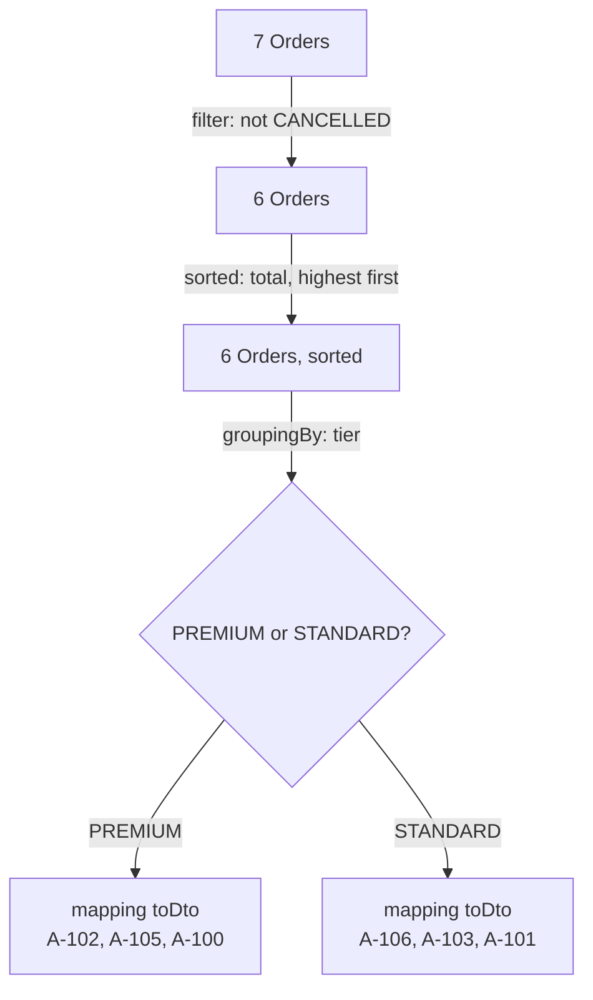

# 3. Stream API

> **In one sentence:** a stream is a pipeline that data flows through: you describe *what* you want (filter, transform, collect) and the library does the looping.

Demo code: `src/main/java/com/training/demo/streams/demo/`

---

## 3.1 Why streams exist: before and after

"How many orders are paid?"

**Before: say HOW, step by step**

```java
int paid = 0;
for (Order o : orders) {
    if (o.isPaid()) {
        paid++;
    }
}
```

**After: say WHAT**

```java
long paid = orders.stream()
        .filter(Order::isPaid)
        .count();
```

Streams are where lambdas and functional interfaces pay off: `filter` takes a `Predicate`, `map` takes a `Function`, `forEach` takes a `Consumer`, `reduce` takes a `BinaryOperator`.

---

## 3.2 What a stream is, and what it is NOT

| A stream IS | A stream is NOT |
|---|---|
| a pipeline of operations over some elements | a data structure: it stores nothing |
| lazy: work happens only when a result is asked for | a way to modify the source: `filter` does not remove from the List |
| single use: consumed by its terminal operation | reusable: calling a second terminal op throws |

```java
Stream<Order> premium = orders.stream().filter(Order::premium);
premium.count();   // 3
premium.count();   // IllegalStateException
```

Real output of `Demo01_WhatIsAStream`:

```text
  second use: IllegalStateException -> stream has already been operated upon or closed
```

**Fix:** ask the source for a new stream each time: `orders.stream()...`.

Run: `Demo01_WhatIsAStream`

---

## 3.3 Where streams come from

| Source | Example | Note |
|---|---|---|
| Any collection | `orders.stream()` | the most common one |
| A few values | `Stream.of("NEW", "PAID", "SHIPPED")` | |
| An array | `Arrays.stream(dailyRevenue)` | `double[]` gives a `DoubleStream` (has `sum()`) |
| A range of numbers | `IntStream.range(1, 4)` | 1, 2, 3 (end is exclusive) |
| Lines of a file | `Files.lines(path)` | keeps the file open: **always** use try-with-resources |
| Generated values | `Stream.iterate(200, n -> n + 1).limit(3)` | infinite without `limit` |

```java
try (Stream<String> lines = Files.lines(csv)) {
    List<String> ids = lines.map(line -> line.split(";")[0]).toList();
}   // file is closed here, even if an exception was thrown
```

Run: `Demo02_StreamSources`

---

## 3.4 The pipeline: source -> intermediate -> terminal



- **Source:** where elements come from. Exactly one.
- **Intermediate operations:** each returns a new `Stream`, so you can chain them. Zero or more. They are **lazy**.
- **Terminal operation:** produces the result (a value, a collection, or a side effect) and **starts** the work. Exactly one, at the end.

| Intermediate (returns a Stream, lazy) | What it does | Terminal (produces a result, starts the work) | What it does |
|---|---|---|---|
| `filter(Predicate)` | keep matching elements | `collect(Collector)` / `toList()` | build a List, Map, String... |
| `map(Function)` | turn each element into something else | `reduce(identity, BinaryOperator)` | combine all into one value |
| `flatMap(Function)` | turn each element into a stream, flatten them | `forEach(Consumer)` | do something with each element |
| `sorted()` / `sorted(Comparator)` | sort | `count()` | how many elements |
| `distinct()` | drop duplicates (uses `equals`) | `anyMatch(Predicate)` | is at least one true? (short-circuits) |
| `limit(n)` | keep the first n (short-circuits) | | |
| `skip(n)` | drop the first n | | |

Real output of `Demo03_IntermediateAndTerminal` (selected lines):

```text
flatMap  (order -> its SKUs): [BOOK-1, PEN-2, PEN-2, LAPTOP-9, BAG-3, BOOK-1, BOOK-7, PEN-2, MUG-4, HEADSET-5, LAPTOP-9]
distinct (unique SKUs)      : [BOOK-1, PEN-2, LAPTOP-9, BAG-3, BOOK-7, MUG-4, HEADSET-5]
sorted   (by total, desc)   : [A-106, A-102, A-105, A-100, A-103, A-101, A-104]
reduce   (sum of totals)    : 2059.49
```

Run: `Demo03_IntermediateAndTerminal`

---

## 3.5 Laziness

Three facts, all visible in `Demo04_Laziness` because every step prints:

1. **Nothing runs without a terminal operation.** Building the pipeline only *describes* the work.
2. **Elements flow one at a time** through the whole pipeline: `filter A-100`, `map A-100`, `filter A-101`, `filter A-102`, `map A-102`... It is *not* "filter everything, then map everything".
3. **Short-circuiting:** `limit(2)` stops pulling as soon as it has two elements. The rest of the source is never read.



Real output of part 3 of `Demo04_Laziness`:

```text
=== 3) limit(2) short-circuits: stops after 2 matches ===
    filter A-100
    filter A-101
    filter A-102
  result: [A-100, A-102]   (A-103 .. A-106 were never looked at)
```

Run: `Demo04_Laziness`

---

## 3.6 Collectors

`collect(...)` turns a stream back into a normal Java object. The four you will use every week:

**`toList`: "the ids of the orders to ship"**

```java
List<String> toShip = orders.stream()
        .filter(Order::isPaid)
        .map(Order::id)
        .collect(Collectors.toList());     // Java 16+: .toList()
// [A-100, A-103, A-105]
```

(`Stream.toList()` returns an unmodifiable list; `Collectors.toList()` makes no promise either way.)

**`toMap`: "look up a total by order id"**

```java
Map<String, Double> totalById = orders.stream()
        .collect(Collectors.toMap(Order::id, Order::total));
totalById.get("A-102");   // 560.0
```

Keys must be unique. By email, bob has two orders, and `toMap` throws (real output):

```text
IllegalStateException -> Duplicate key bob@shop.test (attempted merging values 35.5 and 89.99)
```

Fix: pass a **merge function** that says what to do with two values for the same key:

```java
Map<String, Double> spendByCustomer = orders.stream()
        .collect(Collectors.toMap(Order::customerEmail, Order::total, Double::sum));
// {anna@shop.test=360.0, bob@shop.test=125.49, ...}
```

**`groupingBy`: "orders per status" for the ops dashboard**

```java
Map<OrderStatus, Long> countByStatus = orders.stream()
        .collect(Collectors.groupingBy(Order::status, Collectors.counting()));
// {NEW=2, PAID=3, SHIPPED=1, CANCELLED=1}
```

The second argument (a *downstream collector*) says what to do inside each group: `counting()`, `summingDouble(...)`, `mapping(..., toList())`...

**`joining`: "the To: line for the premium newsletter"**

```java
String toLine = orders.stream()
        .filter(Order::premium)
        .map(Order::customerEmail)
        .distinct()
        .collect(Collectors.joining(", ", "To: ", ";"));
// To: anna@shop.test, carla@shop.test;
```

Run: `Demo05_Collectors` (the demo uses `TreeMap::new` in a few places only so that the printed map has a stable order)

---

## 3.7 End to end: the "orders overview" endpoint

Requirement: skip cancelled orders, convert each `Order` to an `OrderDto` (total with 25% VAT, item count), group by tier `PREMIUM` / `STANDARD`, most expensive first.

**Before:**

```java
Map<String, List<OrderDto>> result = new TreeMap<>();
for (Order o : orders) {
    if (o.status() == OrderStatus.CANCELLED) {
        continue;
    }
    String tier = o.premium() ? "PREMIUM" : "STANDARD";
    result.computeIfAbsent(tier, k -> new ArrayList<>()).add(toDto(o));
}
for (List<OrderDto> group : result.values()) {
    group.sort(Comparator.comparingDouble(OrderDto::totalWithVat).reversed());
}
```

**After:**

```java
Map<String, List<OrderDto>> result = orders.stream()
        .filter(o -> o.status() != OrderStatus.CANCELLED)
        .sorted(Comparator.comparingDouble(Order::total).reversed())
        .collect(Collectors.groupingBy(
                o -> o.premium() ? "PREMIUM" : "STANDARD",
                TreeMap::new,
                Collectors.mapping(Demo06_EndToEndDto::toDto, Collectors.toList())));
```



Real output of `Demo06_EndToEndDto`:

```text
PREMIUM
  A-102  carla@shop.test    700.00  items=2
  A-105  anna@shop.test     300.00  items=1
  A-100  anna@shop.test     150.00  items=2
STANDARD
  A-106  erik@shop.test    1248.75  items=1
  A-103  bob@shop.test      112.49  items=3
  A-101  bob@shop.test       44.38  items=1

loop version gives the same result? true
```

Note that the mapping logic lives in a named method `toDto(...)`, not in a fat lambda.

---

## 3.8 Common Mistakes

**1. Reusing a stream.** A second terminal operation throws `IllegalStateException: stream has already been operated upon or closed`. Create a new stream from the source.

**2. Forgetting the terminal operation.** `orders.stream().filter(...).map(...);` does nothing at all.

**3. Building a result with `forEach` and an outside list.**

```java
// BAD: side effect, not safe if the stream ever becomes parallel
List<String> ids = new ArrayList<>();
orders.stream().filter(Order::isPaid).forEach(o -> ids.add(o.id()));

// GOOD
List<String> ids = orders.stream().filter(Order::isPaid).map(Order::id).toList();
```

**4. `toMap` with duplicate keys.** Throws `IllegalStateException: Duplicate key ...`. Add a merge function, or use `groupingBy`.

**5. Not closing `Files.lines`.** The stream holds the file open. Use try-with-resources.

**6. An infinite stream without `limit`.** `Stream.iterate(1, n -> n + 1).toList()` never finishes.

**7. Expecting the source to change.** `orders.stream().sorted()` does not sort `orders`. It gives you a sorted *stream*.

---

## 3.9 Exercises (do them together)

| # | Class | Level | Idea |
|---|---|---|---|
| 1 | `Ex01_FilterAndMap` | easy | `filter` + `map` + `toList` |
| 2 | `Ex02_FlatMapAndReduce` | medium | `flatMap`, `distinct`, `sorted`, `reduce` |
| 3 | `Ex03_Collectors` | medium | `groupingBy` + `counting`, `toMap` with merge, `joining` |
| 4 | `Ex04_TopCustomers` | hard | end to end: group, sort map entries, `limit` |

Run one: `mvn test -Dtest=Ex04_TopCustomersTest`

Previous: [2. Functional Interfaces](02-functional-interfaces.md) | Back to [README](../README.md)
