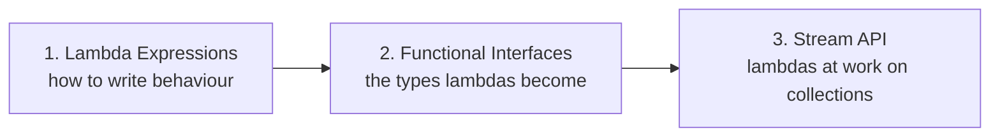

# Java Functional Programming Training

A hands-on introduction to the functional style that Java 8 added: **lambdas**, **functional interfaces** and **streams**. It is written for developers who are comfortable with core Java (OOP, collections, generics) but have never used a lambda. Nothing here assumes you have seen this style before.

## Prerequisites

- **JDK 17 or newer.** The code is compiled with `--release 17`. Check with `java -version`.
- **Maven 3.8 or newer.** Check with `mvn -v`.
- An IDE (IntelliJ IDEA, VS Code with the Java extensions, or Eclipse). Open the root `pom.xml` as a project and all three modules are imported.

The only dependency is JUnit 5, for the tests.

## Topics, in order

Work through them in this order. Each topic builds on the one before.

| # | Topic | Folder | You'll learn |
|---|-------|--------|--------------|
| 1 | [Lambda Expressions](lambda-expressions/README.md) | `lambda-expressions/` | Why lambdas exist, syntax, capturing variables, method references |
| 2 | [Functional Interfaces](functional-interfaces/README.md) | `functional-interfaces/` | What makes an interface "functional", `java.util.function`, custom interfaces, `andThen` / `compose` / `and` / `or` / `negate` |
| 3 | [Stream API](stream-api/README.md) | `stream-api/` | What a stream is, sources, intermediate vs terminal operations, laziness, collectors, a realistic DTO pipeline |



## How each topic is organised

```text
<topic>/
├── README.md                          concept explanation: start here
└── src/
    ├── main/java/com/training/<topic>/
    │   ├── examples/     ExampleNN_*.java   one small idea per file, each with a main()
    │   ├── exercises/    ExerciseN_*.java   stubs with TODOs and hints, easy to hard
    │   ├── solutions/    ExerciseN_*.java   worked solutions with the reasoning explained
    │   └── model/                           small records shared by exercises and tests
    └── test/java/com/training/<topic>/
        └── ExerciseN_*Test.java             one JUnit 5 test class per exercise
```

## Suggested way to work

1. Read the topic's `README.md` from top to bottom.
2. Run the examples it links to, one at a time, and read their comments.
3. Open `Exercise1_...`, read the Javadoc and the hint, and replace the `throw new UnsupportedOperationException(...)` with your code.
4. Run that exercise's test. Red means not done yet; green means done.
5. Only when you're green (or truly stuck), compare with the file of the same name in `solutions/`. Read its comments, because the reasoning matters more than the code.

## Running things

Run every command from this root folder.

Run all tests in all topics. They are expected to fail until you have solved the exercises:

```bash
mvn test
```

Run the tests for one topic:

```bash
mvn test -pl lambda-expressions
```

Run the tests for one exercise:

```bash
mvn test -pl lambda-expressions -Dtest=Exercise1_AnonymousToLambdaTest
```

Run an example. The easiest way is the green run arrow next to `main` in your IDE. From a terminal, compile first:

```bash
mvn -q compile -pl lambda-expressions
```

```bash
java -cp lambda-expressions/target/classes com.training.lambdas.examples.Example01_AnonymousClassVsLambda
```

For the other topics, swap in the module name and package: `functional-interfaces` with `com.training.functionalinterfaces.examples.…`, and `stream-api` with `com.training.streams.examples.…`.

### What a failing exercise looks like

```text
[ERROR]   Exercise1_AnonymousToLambdaTest.byLengthSortsShortestFirst:19 » UnsupportedOperation TODO: Exercise 1 - byLength
```

That message means "you haven't written this method yet". Once you have, a failure shows the expected and actual values instead.

`mvn test` keeps going after a failing topic (see `.mvn/maven.config`), so you always get results for all three topics.

## For trainers

- [`TRAINER_NOTES.md`](TRAINER_NOTES.md) has talking points, timings and the misconceptions to watch for in each topic.
- To check that every solution passes the same tests the interns run:

  ```bash
  mvn clean test -Psolutions
  ```

  This profile, defined in the root `pom.xml`, runs a copy of the tests pointed at `solutions` instead of `exercises`. Use `clean` whenever you switch between a normal run and a `-Psolutions` run.
