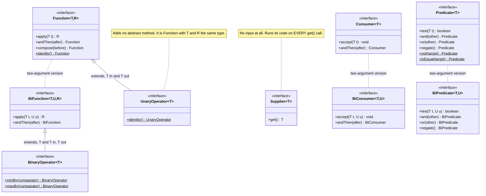
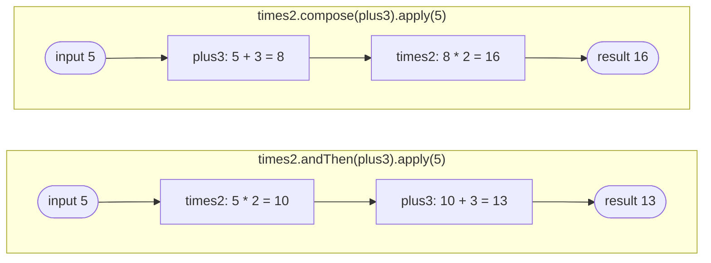

# Topic 2 - Functional Interfaces

In Topic 1 you wrote lambdas like `s -> s.length()`. But a lambda on its own has no type.
It always needs a *target*: a variable, parameter or return type whose type is a
**functional interface**. This topic is about those interfaces - what they are, the ones the
JDK gives you, and the default methods that let you snap small functions together.

---

## 1. Why functional interfaces exist

Imagine an order service that needs to filter orders in different ways: unpaid ones, big
ones, ones going abroad. The filter is *behaviour* you want to pass into a method.

### Before Java 8

You had to invent a one-method interface for every kind of callback, and pass an anonymous
class every time you used it:

```java
// A hand-written interface, just to pass one piece of behaviour around.
interface OrderFilter {
    boolean accept(Order o);
}

static List<Order> filter(List<Order> orders, OrderFilter filter) {
    List<Order> result = new ArrayList<>();
    for (Order o : orders) {
        if (filter.accept(o)) {
            result.add(o);
        }
    }
    return result;
}

// Caller: six lines of ceremony for one line of logic.
List<Order> unpaid = filter(orders, new OrderFilter() {
    @Override
    public boolean accept(Order o) {
        return !o.paid();
    }
});
```

Problems:

- **Every library invents its own interface.** `OrderFilter`, `CustomerFilter`, `ProductMatcher`...
  all mean "a yes/no question about a T", but none of them are compatible with each other.
- **Anonymous classes are noisy.** The real logic (`!o.paid()`) is buried.
- **No shared toolkit.** Want "unpaid AND abroad"? You write that combining code yourself, again, for each interface.

### After Java 8

The JDK ships a standard set of functional interfaces in `java.util.function`, and a lambda
can be used wherever one is expected:

```java
static List<Order> filter(List<Order> orders, Predicate<Order> filter) {
    List<Order> result = new ArrayList<>();
    for (Order o : orders) {
        if (filter.test(o)) {
            result.add(o);
        }
    }
    return result;
}

List<Order> unpaid = filter(orders, o -> !o.paid());
List<Order> unpaidAbroad = filter(orders, Predicate.not(Order::paid).and(o -> !"NO".equals(o.country())));
```

- One **standard** type (`Predicate<T>`) that every library understands.
- The lambda is the **whole** implementation - no class, no `@Override`.
- **Free combinators** (`and`, `or`, `negate`) because they are default methods on the shared interface.

That is the whole idea: *a functional interface is the type that gives a lambda somewhere to live.*

---

## 2. What makes an interface functional?

An interface is functional if it has **exactly one abstract method**. The lambda becomes the
body of that method. (`Example01_WhatMakesItFunctional`)

These do **not** count towards the "one":

| Kind of method | Counts? | Why |
|---|---|---|
| `default` methods | No | They already have a body. |
| `static` methods | No | They already have a body, and belong to the interface, not to instances. |
| Abstract re-declarations of public `java.lang.Object` methods, e.g. `boolean equals(Object o)` | No | Every object already inherits an implementation from `Object`. `java.util.Comparator` declares both `compare` and `equals` and is still functional. |
| Abstract methods **inherited** from a parent interface | **Yes** | They are still holes someone has to fill. |

Zero abstract methods is *not* functional either - the rule is **exactly** one.

### `@FunctionalInterface`

The annotation is **optional**. An interface with one abstract method is functional with or
without it. It exists for two reasons (`Example02_FunctionalInterfaceAnnotation`):

1. **Compiler guard** - if someone adds a second abstract method later, compilation fails *at the interface*.
2. **Documentation** - it tells readers "this is meant for lambdas, keep it to one abstract method".

What happens when you break the rule (messages from `javac`, JDK 21 with `--release 17`):

**With the annotation** - the error points at the interface itself:

```java
@FunctionalInterface
interface PriceRule {
    double apply(double price);
    String describe();
}
```

```text
Broken.java:1: error: Unexpected @FunctionalInterface annotation
@FunctionalInterface
^
  PriceRule is not a functional interface
    multiple non-overriding abstract methods found in interface PriceRule
```

(With zero abstract methods the last line reads `no abstract method found in interface ...`.)

**Without the annotation** - the interface compiles happily. The error only appears where
someone tries to use a lambda, which may be in a completely different file:

```java
interface PriceRule {
    double apply(double price);
    String describe();
}

PriceRule r = price -> price * 0.9;
```

```text
NoAnno.java:6: error: incompatible types: PriceRule is not a functional interface
    PriceRule r = price -> price * 0.9;
                  ^
    multiple non-overriding abstract methods found in interface PriceRule
```

Rule of thumb: if you write an interface *meant* for lambdas, annotate it.

---

## 3. The core interfaces in `java.util.function`



(Methods marked `$` are static. Arrows with a hollow triangle mean "extends"; dotted lines
just mean "related".)

| Interface | Abstract method | Reach for it when... |
|---|---|---|
| `Function<T, R>` | `R apply(T t)` | you turn one value into another (String -> Integer, Order -> OrderDto). |
| `BiFunction<T, U, R>` | `R apply(T t, U u)` | the result needs two inputs (price and quantity -> line total). |
| `UnaryOperator<T>` | `T apply(T t)` | input and output are the same type (trim a String, apply a discount). |
| `BinaryOperator<T>` | `T apply(T a, T b)` | you combine two values of the same type into one (sum, max, merge). |
| `Supplier<T>` | `T get()` | you need to produce a value later, lazily, or many times (factories, fallbacks, ids). |
| `Consumer<T>` | `void accept(T t)` | you do something *with* a value and return nothing (log it, save it, send it). |
| `BiConsumer<T, U>` | `void accept(T t, U u)` | the same, with two values - e.g. `Map.forEach((key, value) -> ...)`. |
| `Predicate<T>` | `boolean test(T t)` | you ask a yes/no question about a value (filters, validation rules). |
| `BiPredicate<T, U>` | `boolean test(T t, U u)` | the yes/no question needs two values (`(text, minLength) -> ...`). |

Notes:

- **`Runnable`** (`void run()`, no input, no output) is also a functional interface, but it lives in
  **`java.lang`**, not `java.util.function` - it predates Java 8. `Callable<V>` is in `java.util.concurrent`.
- **Primitive specialisations** like `IntPredicate`, `IntFunction<R>`, `ToIntFunction<T>`,
  `IntUnaryOperator`, `IntSupplier` (and `Long`/`Double` versions) do the same jobs with
  `int`/`long`/`double` instead of boxed `Integer`/`Long`/`Double`, avoiding boxing cost. Use them
  when a hot loop deals with primitives; otherwise the generic versions are fine.

Examples: `Example03_FunctionAndBiFunction`, `Example04_SupplierAndConsumer`,
`Example05_PredicateAndBiPredicate`, `Example06_UnaryAndBinaryOperator`.

---

## 4. Writing your own functional interface

It is not magic. A lambda is just a short way to write "a class implementing the one abstract
method". Here is a custom interface, used three ways (`Example07_CustomFunctionalInterface`):

```java
@FunctionalInterface
interface ShippingPolicy {
    double cost(double weightKg, String country, boolean express);
}

// 1. A named class
class StandardShipping implements ShippingPolicy {
    public double cost(double weightKg, String country, boolean express) { ... }
}

// 2. An anonymous class (pre-Java 8 style)
ShippingPolicy anon = new ShippingPolicy() {
    public double cost(double weightKg, String country, boolean express) { ... }
};

// 3. A lambda: its parameters and body ARE cost(...)'s parameters and body
ShippingPolicy lambda = (weightKg, country, express) -> {
    double base = "NO".equals(country) ? 49 : 149;
    return base + weightKg * 10 + (express ? 100 : 0);
};

lambda.cost(2, "NO", false);   // 69.0 - you call it through the interface method, like any object
```

The compiler knows the lambda is `cost(...)` because that is the *only* abstract method -
which is exactly why the "one abstract method" rule exists.

Write your own when:
- a **domain name** makes code clearer (`DiscountRule` says more than `UnaryOperator<Double>`),
- you need **more than two parameters** (there is no `TriFunction` in the JDK),
- you need to **declare a checked exception** (`java.util.function` methods declare none).

Otherwise, prefer the standard ones - every developer and library already knows them.

---

## 5. Default and static methods: snapping functions together

Because the core interfaces have default methods, you can build bigger behaviour out of small
pieces **without writing new classes**. None of these methods *run* anything - they return a
**new** function object. The work happens only when you finally call `apply`/`test`/`accept`.

### `Function.andThen` and `Function.compose` (`Example08_AndThenVsCompose`)

```java
Function<Integer, Integer> times2 = x -> x * 2;
Function<Integer, Integer> plus3  = x -> x + 3;

times2.andThen(plus3).apply(5);   // 13   first times2, THEN plus3:  (5 * 2) + 3
times2.compose(plus3).apply(5);   // 16   plus3 FIRST, then times2:  (5 + 3) * 2
```

- `f.andThen(g)` = `x -> g(f(x))` - reads left to right in the order things happen.
- `f.compose(g)` = `x -> f(g(x))` - the argument runs *first* (like maths: f of g of x).



Tip: if you are unsure, use `andThen` - the code reads in execution order.
`plus3.andThen(times2)` is exactly the same as `times2.compose(plus3)`.

### `Predicate.and` / `or` / `negate` (`Example09_PredicateCombinators`)

```java
Predicate<Order> isPaid     = Order::paid;
Predicate<Order> isFlagged  = Order::flaggedForFraud;
Predicate<Order> isDomestic = o -> "NO".equals(o.country());
Predicate<Order> isHigh     = o -> o.total() >= 500;

Predicate<Order> express = isPaid
        .and(isFlagged.negate())
        .and(isHigh.or(isDomestic));     // the nested call acts as brackets
```

**Execution order**, for `express.test(order)`:
1. `isPaid` is tested. If false, stop - answer `false`.
2. `isFlagged` is tested and negated. If the result is false, stop - answer `false`.
3. `isHigh` is tested. If true, stop - answer `true` (`isDomestic` is never called).
4. Otherwise `isDomestic` decides.

**Short-circuiting:** `and` is built on `&&`, `or` is built on `||`, so they skip the second
predicate when the answer is already known:

- `p.and(q)`: if `p` is **false**, `q` is **not called**.
- `p.or(q)`: if `p` is **true**, `q` is **not called**.

This matters when `q` is slow (a call to a fraud service) or has side effects. Put the cheap
test first.

### `Consumer.andThen` (`Example10_ConsumerAndThen`)

```java
Consumer<String> audit  = auditLog::add;
Consumer<String> notify = e -> mailer.send("Event: " + e);

audit.andThen(notify).accept("ORD-7 shipped");   // audit runs first, then notify - both get the SAME string
```

Unlike `Function.andThen`, the second consumer does not get a "result" (there is none) - it
gets the original value again.

### Static helpers (`Example11_StaticHelpers`)

| Helper | What it gives you | Typical use |
|---|---|---|
| `Function.identity()` | `x -> x` | a "do nothing" starting point when chaining in a loop, or an API that insists on a Function. |
| `UnaryOperator.identity()` | `x -> x`, typed as UnaryOperator | the same, when you need a UnaryOperator. |
| `Predicate.not(p)` (Java 11+) | the opposite of `p` | negating a **method reference**: `Predicate.not(String::isBlank)`. You cannot write `String::isBlank.negate()` - javac says `method reference not expected here`. |
| `Predicate.isEqual(x)` | `y -> Objects.equals(x, y)` | a null-safe equality test: `Predicate.isEqual("NO")`. |

---

## 6. Common mistakes

**1. Mixing up `andThen` and `compose`.**
`vat.andThen(round)` adds VAT then rounds; `vat.compose(round)` rounds then adds VAT. With a
price of 10.4 and 25 % VAT, one gives 13.0 and the other 12.5 - and both compile. Default to
`andThen`, and write a test with a value where the order matters (Exercise 4).

**2. Using `Function<T, Boolean>` instead of `Predicate<T>`.**
It looks the same, but it is a different type, so JDK methods that expect a Predicate reject it:

```java
Function<String, Boolean> f = s -> s.isEmpty();
List<String> l = new ArrayList<>();
l.removeIf(f);
```
```text
F.java:7: error: incompatible types: Function<String,Boolean> cannot be converted to Predicate<? super String>
        l.removeIf(f);
                   ^
```
You also lose `and`/`or`/`negate`, and a `Boolean` can be `null` (unboxing a null `Boolean`
in an `if` throws `NullPointerException`). If it answers yes/no, use `Predicate`.

**3. Adding a second abstract method to an interface that is used with lambdas.**
Without `@FunctionalInterface`, this breaks every lambda that targets it, with an error far
away from the change (see section 2). Annotate interfaces meant for lambdas. If you need
another method, make it `default`.

**4. Side effects inside predicates.**
A predicate should *answer a question*, not *do things*. Because of short-circuiting, a
predicate inside `and`/`or` may run zero times or once - so a counter, log line or database
write inside it runs "sometimes". Keep predicates pure; put side effects in a Consumer.

**5. Expecting a `Supplier` to cache its value.**
`Supplier<Rates> rates = () -> loadRatesFromBank();` calls the bank on **every** `get()`.
A Supplier is code that has not run yet, not a stored value. If you want "compute once",
you must build that yourself (Exercise 6, `memoize`).
Related: `map.getOrDefault(key, fallback.get())` calls `fallback.get()` *before*
`getOrDefault` even runs - arguments are always evaluated first.

**6. Calling the wrong method name.**
Each interface has its own name for its one method: `apply` (Function family), `test`
(Predicate family), `accept` (Consumer family), `get` (Supplier), `run` (Runnable).

```java
Predicate<String> p = s -> s.isEmpty();
p.apply("x");
```
```text
E.java:5: error: cannot find symbol
        p.apply("x");
         ^
  symbol:   method apply(String)
  location: variable p of type Predicate<String>
```

**7. (Bonus, Exercise 7) Expecting `UnaryOperator.andThen` to return a `UnaryOperator`.**
It is inherited from `Function`, so it returns a `Function`:

```java
UnaryOperator<String> acc = UnaryOperator.identity();
acc = acc.andThen(op);
```
```text
U.java:2: error: incompatible types: no instance(s) of type variable(s) V exist so that Function<String,V> conforms to UnaryOperator<String>
```
Keep the accumulator as `Function<T, T>` and convert at the end (`return acc::apply;`).

(All error messages above were produced with JDK 21 `javac --release 17`.)

---

## 7. Exercises

Work in `src/main/java/com/training/functionalinterfaces/exercises/`. Each method throws
`UnsupportedOperationException("TODO: ...")` until you implement it. Read the class Javadoc,
the method Javadoc and the `// Hint:` comment, then make the matching test pass.
Shared types (`Order`, `DiscountRule`) are in the `model` package.

| # | Class | What you practise | Difficulty |
|---|---|---|---|
| 1 | `Exercise1_IsItFunctional` | The "exactly one abstract method" rule: defaults, statics, `equals`, inheritance | Easy |
| 2 | `Exercise2_PickTheInterface` | Returning a lambda / method reference of each core interface for small backend tasks | Easy |
| 3 | `Exercise3_DiscountRules` | Using a custom functional interface (`DiscountRule`), writing your own chaining | Easy/Medium |
| 4 | `Exercise4_FunctionComposition` | `andThen` vs `compose`, and why order changes the result | Medium |
| 5 | `Exercise5_PredicateCombinators` | `and` / `or` / `negate` / `Predicate.not`, grouping, short-circuiting | Medium |
| 6 | `Exercise6_SupplierLaziness` | Laziness, memoization, stateful Suppliers, `Consumer.andThen` | Medium/Hard |
| 7 | `Exercise7_RuleEngine` | Generic `allOf` / `anyOf` / `pipeline` / `failedRules` over any `T` | Hard |

### Running the tests

All commands are run from the **project root** (the folder with the parent `pom.xml`).

Run all tests for this topic:

```bash
mvn -q clean test -pl functional-interfaces
```

Before you start, all 64 tests fail with `UnsupportedOperationException` - that is expected.

Run one test class:

```bash
mvn test -pl functional-interfaces -Dtest=Exercise3_DiscountRulesTest
```

Run one single test method (put it in quotes so your shell leaves the `#` alone):

```bash
mvn test -pl functional-interfaces "-Dtest=Exercise3_DiscountRulesTest#percentOff"
```

You can also run any test class from your IDE with the green run arrow next to the class name.

### Running an example

Easiest: open the example in your IDE and run its `main` method.

From the command line:

```bash
mvn -q compile -pl functional-interfaces
```

```bash
java -cp functional-interfaces/target/classes com.training.functionalinterfaces.examples.Example01_WhatMakesItFunctional
```

Swap the class name for any other example:

| Example | Idea |
|---|---|
| `Example01_WhatMakesItFunctional` | One abstract method; defaults, statics and `equals` don't count |
| `Example02_FunctionalInterfaceAnnotation` | What `@FunctionalInterface` does, with the real compiler errors |
| `Example03_FunctionAndBiFunction` | Function and BiFunction |
| `Example04_SupplierAndConsumer` | Supplier, Consumer, BiConsumer with `Map.forEach` |
| `Example05_PredicateAndBiPredicate` | Predicate and BiPredicate |
| `Example06_UnaryAndBinaryOperator` | UnaryOperator / BinaryOperator as special cases of Function / BiFunction |
| `Example07_CustomFunctionalInterface` | Your own interface: named class vs anonymous class vs lambda |
| `Example08_AndThenVsCompose` | Execution order traced step by step |
| `Example09_PredicateCombinators` | `and` / `or` / `negate` with short-circuit trace |
| `Example10_ConsumerAndThen` | Two consumers, same value, in order |
| `Example11_StaticHelpers` | `Function.identity()`, `Predicate.not()`, `Predicate.isEqual()` |
