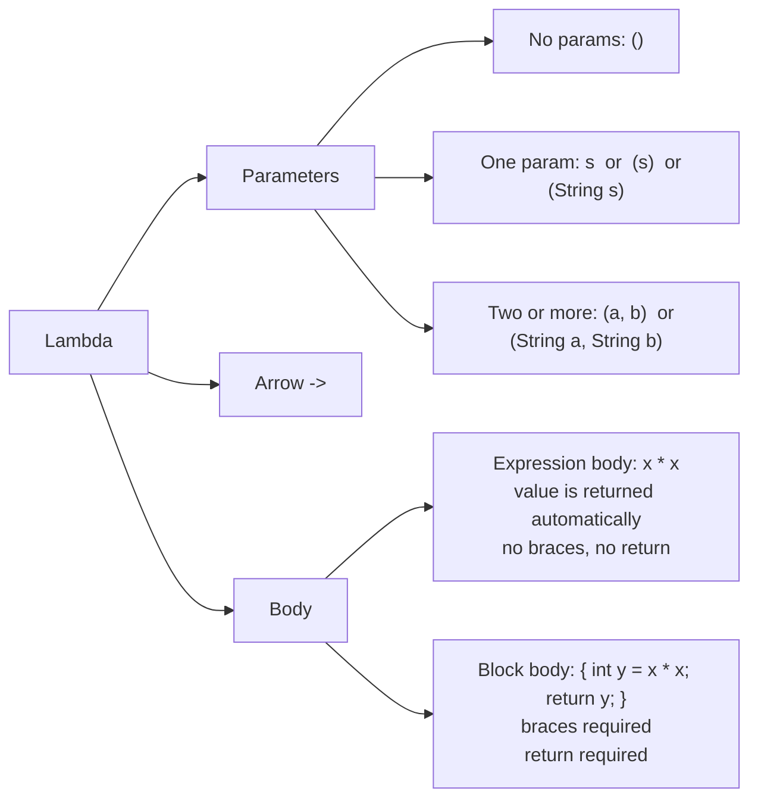
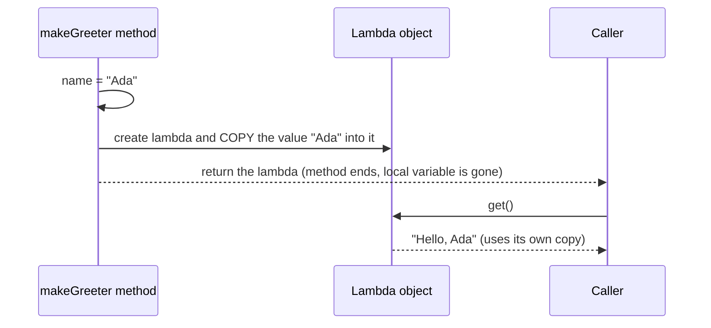
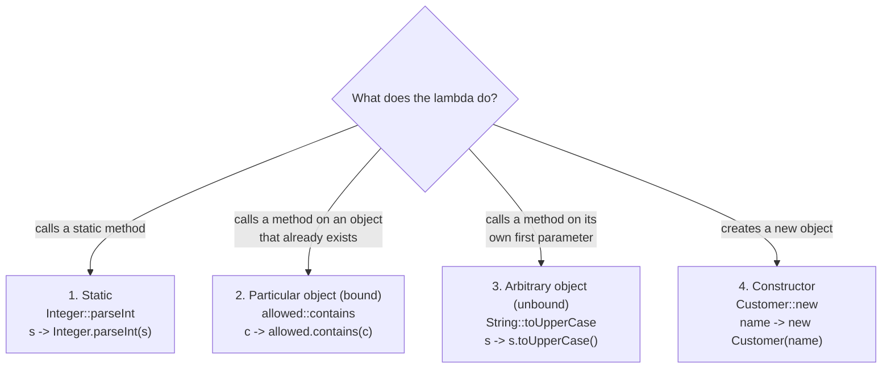

# Topic 1: Lambda Expressions

## Why lambdas exist

Plenty of APIs need you to hand them a small piece of **behaviour**, not just data:

- `list.sort(...)` needs to know *how to compare two elements*
- `executor.submit(...)` needs *a task to run*
- a Kafka listener or an HTTP handler needs *what to do when something arrives*

Java is object-oriented, so before Java 8 the only way to pass behaviour was to wrap it in an object. Usually that meant an **anonymous inner class**, which is a lot of code for very little logic.

### Before (pre-Java 8): an anonymous inner class

```java
List<String> words = new ArrayList<>(List.of("banana", "fig", "apple"));

words.sort(new Comparator<String>() {
    @Override
    public int compare(String a, String b) {
        return Integer.compare(a.length(), b.length());
    }
});
```

Six lines, and only one of them (`Integer.compare(...)`) says what we actually want. The rest is ceremony: the interface name, `@Override`, the method signature, the types, `return`, and braces.

### After (Java 8+): a lambda

```java
words.sort((a, b) -> Integer.compare(a.length(), b.length()));
```

The compiler already knows `sort` expects a `Comparator<String>`, and that `Comparator` has exactly one method to implement, `compare(String, String)`, which returns `int`. So you only write the part that changes: **the parameters and the body**.

> A lambda is not magic and not a new kind of object. It is a short way to create an object that implements an interface with exactly **one** abstract method. Topic 2 covers that rule.

Example: [`Example01_AnonymousClassVsLambda`](src/main/java/com/training/lambdas/examples/Example01_AnonymousClassVsLambda.java)

---

## Syntax: parameters, arrow, body

Every lambda has three parts:

```text
 (a, b)     ->     Integer.compare(a.length(), b.length())
 ------     --     ---------------------------------------
parameters  arrow  body
```



### All the forms

| Form | Example | Notes |
|------|---------|-------|
| No parameters | `() -> "guest"` | Empty `()` is required |
| One parameter, shortest form | `s -> s.length()` | Parentheses may be dropped **only** for exactly one parameter without a type |
| One parameter, in parentheses | `(s) -> s.length()` | Same meaning as the shortest form |
| Explicit types | `(String s) -> s.length()` | Rarely needed; the type is inferred from the interface |
| Two parameters | `(a, b) -> a + b` | Parentheses required |
| Expression body | `x -> x * x` | The expression's value is returned |
| Block body | `x -> { int y = x * x; return y; }` | Braces mean normal statements, so `return` is required |

**The one rule to remember:** with braces you write `return`, without braces you must not.

Examples: [`Example02_ParameterForms`](src/main/java/com/training/lambdas/examples/Example02_ParameterForms.java), [`Example03_ExpressionVsBlockBody`](src/main/java/com/training/lambdas/examples/Example03_ExpressionVsBlockBody.java)

---

## Capturing variables: why they must be effectively final

A lambda can use local variables from the method around it:

```java
double vatRate = 0.25;
Function<Double, Double> withVat = price -> price * (1 + vatRate);   // uses vatRate
```

But only if the variable is **effectively final**: it is assigned once and never changed afterwards. You don't have to write `final`; the compiler checks it for you. If you break the rule:

```java
int count = 0;
Runnable r = () -> count++;
// error: local variables referenced from a lambda expression must be final or effectively final
```

### Why? Because a lambda can run *later*, somewhere else

```java
static Supplier<String> makeGreeter(String name) {
    return () -> "Hello, " + name;
}

Supplier<String> greeter = makeGreeter("Ada");
// makeGreeter has returned. Its local variable 'name' is gone from the stack...
greeter.get();   // ...yet this still returns "Hello, Ada"
```

How can the lambda still see `name`? When the lambda is created, Java **copies the value** into the lambda object. The lambda carries its own private copy.

Now imagine Java let you change the variable afterwards:

```java
String name = "Ada";
Supplier<String> s = () -> "Hello, " + name;   // the copy says "Ada"
name = "Bob";                                  // the variable says "Bob"
s.get();                                       // "Ada" or "Bob"?
```

The code *looks* like it reads one variable, but there would really be two values that no longer agree. It gets much worse when the lambda runs on another thread, which it often does in backend code: thread pools, `CompletableFuture`, Kafka consumers. Java removes the question entirely. If the variable can never change, the copy and the original are always the same.



**Notes:**
- **The loop-variable trap.** In `for (int i = 0; i < n; i++)`, `i` changes every iteration, so a lambda can't capture it. Copy it into a new variable inside the loop: `int number = i;`. The enhanced `for (String s : list)` loop does *not* have this problem, because `s` is a new variable each iteration. See [`Example05_CaptureInLoops`](src/main/java/com/training/lambdas/examples/Example05_CaptureInLoops.java).
- **The variable is fixed, not the object.** Capturing a `List` variable is fine even if you add elements to the list. What you may not do is point the variable at a different list.
- **Fields are different.** Inside an instance method, a lambda may read and change fields. It captures `this`, which never changes, rather than a copy of the field.

Example: [`Example04_EffectivelyFinal`](src/main/java/com/training/lambdas/examples/Example04_EffectivelyFinal.java)

---

## Method references

When a lambda does nothing except call one existing method, you can write a **method reference** instead: `ClassName::methodName` or `object::methodName`. Read `::` as "use this method".

```java
Function<String, Integer> lambda = s -> Integer.parseInt(s);
Function<String, Integer> ref    = Integer::parseInt;   // same thing
```

There are four kinds. The difference is *where the object the method is called on comes from*.



### 1. Static method: `ClassName::staticMethod`

```java
Function<String, Integer> parse = Integer::parseInt;          // s -> Integer.parseInt(s)
BiFunction<Integer, Integer, Integer> max = Math::max;        // (a, b) -> Math.max(a, b)
```

The lambda's parameters are passed to the static method in order.
Example: [`Example06_StaticMethodReference`](src/main/java/com/training/lambdas/examples/Example06_StaticMethodReference.java)

### 2. Instance method on a particular object: `object::method`

```java
Set<String> allowedCountries = Set.of("NO", "SE", "DK");
Predicate<String> isAllowed = allowedCountries::contains;     // code -> allowedCountries.contains(code)

Consumer<String> print = System.out::println;                 // s -> System.out.println(s)
```

The object on the left already exists and is fixed when the reference is created. The lambda's parameters become the method's arguments.
Example: [`Example07_BoundInstanceMethodReference`](src/main/java/com/training/lambdas/examples/Example07_BoundInstanceMethodReference.java)

### 3. Instance method on an arbitrary object: `ClassName::instanceMethod`

```java
Function<String, String> upper = String::toUpperCase;               // s -> s.toUpperCase()
Comparator<String> ignoreCase = String::compareToIgnoreCase;        // (a, b) -> a.compareToIgnoreCase(b)
```

It looks like kind 1, but `toUpperCase` is **not** static. There is no object yet, so the **first parameter becomes the object** the method is called on, and any remaining parameters become the arguments.
Example: [`Example08_UnboundInstanceMethodReference`](src/main/java/com/training/lambdas/examples/Example08_UnboundInstanceMethodReference.java)

### 4. Constructor: `ClassName::new`

```java
Supplier<List<String>> newList = ArrayList::new;                    // () -> new ArrayList<>()
Function<String, Customer> fromName = Customer::new;                // name -> new Customer(name)
BiFunction<String, String, Customer> full = Customer::new;          // (n, e) -> new Customer(n, e)
IntFunction<String[]> newArray = String[]::new;                     // size -> new String[size]
```

The same `Customer::new` can call different constructors. The compiler picks the one whose parameters match the interface.
Example: [`Example09_ConstructorReference`](src/main/java/com/training/lambdas/examples/Example09_ConstructorReference.java)

**When to use which:** if the lambda is *only* a call like `x -> foo(x)`, a method reference is usually clearer. If the lambda does anything else, such as `x -> foo(x) + 1`, keep the lambda.

---

## Common Mistakes

### 1. Changing a captured local variable

```java
int total = 0;
orders.forEach(o -> total += o.amount());   // does not compile: total is not effectively final
```

A common "fix" is a one-element array, `int[] total = {0}`, or an `AtomicInteger`. It compiles, but it hides the design problem, and the array version is not thread-safe. Usually the better answer is to *return* a value instead of mutating one. For example, in Topic 3 you'll write `orders.stream().mapToInt(Order::amount).sum()`.

### 2. Capturing the loop counter

```java
for (int i = 0; i < 3; i++) {
    tasks.add(() -> System.out.println(i));   // does not compile: i changes every iteration
}
```

Fix: `int n = i;` inside the loop, then use `n`.

### 3. Lambdas that should have been methods

```java
Predicate<String> valid = name -> {
    if (name == null || name.length() < 3 || name.length() > 16) return false;
    if (Character.isDigit(name.charAt(0))) return false;
    for (char c : name.toCharArray()) { /* ...more rules... */ }
    return true;
};
```

If a lambda needs more than two or three lines, give the logic a name. You can then unit test it, reuse it, and read it in a stack trace:

```java
Predicate<String> valid = UsernameRules::isValidUsername;
```

See [`Example10_ExtractComplexLambda`](src/main/java/com/training/lambdas/examples/Example10_ExtractComplexLambda.java).

### 4. Mixing up braces and `return`

| You wrote | What happens |
|-----------|--------------|
| `x -> { x * x; }` | `error: not a statement` |
| `x -> { int y = x * x; }` | `error: incompatible types: bad return type in lambda expression` (missing return value) |
| `x -> return x * x;` | Does not compile: `return` is only allowed inside braces |
| `x -> x * x` or `x -> { return x * x; }` | Correct |

### 5. Picking the wrong method reference kind

`String::length` works as a `Function<String, Integer>` because the parameter *is* the string (kind 3). `myString::length` would be a `Supplier<Integer>` for that one specific string (kind 2). Ask yourself: *does the object already exist, or is it the lambda's parameter?*

---

## Exercises

Stubs are in [`exercises/`](src/main/java/com/training/lambdas/exercises), tests in [`src/test/java`](src/test/java/com/training/lambdas), and worked solutions in [`solutions/`](src/main/java/com/training/lambdas/solutions). Try the exercise before you open its solution.

| # | Exercise | You practise | Difficulty |
|---|----------|--------------|------------|
| 1 | `Exercise1_AnonymousToLambda` | Turning anonymous classes into lambdas | Easy |
| 2 | `Exercise2_SyntaxForms` | Zero, one and two parameters; shortest form | Easy |
| 3 | `Exercise3_BlockBodies` | Multi-step block bodies with `return` | Medium |
| 4 | `Exercise4_VariableCapture` | Effectively final, the loop trap, live objects | Medium |
| 5 | `Exercise5_MethodReferences` | All four method reference kinds | Medium |
| 6 | `Exercise6_ExtractToMethod` | Moving logic out of a lambda | Medium to hard |
| 7 | `Exercise7_CalculatorCommands` | Behaviour stored in a `Map` | Hard |

Run the commands from the **project root** (`java-fp-training/`):

```bash
mvn test -pl lambda-expressions
```

```bash
mvn test -pl lambda-expressions -Dtest=Exercise3_BlockBodiesTest
```

Every test starts red with `UnsupportedOperationException: TODO: ...`. Replace the `throw` with your code and run again until it turns green.

Run an example from your IDE (the green arrow next to `main`), or from the terminal:

```bash
mvn -q compile -pl lambda-expressions
```

```bash
java -cp lambda-expressions/target/classes com.training.lambdas.examples.Example04_EffectivelyFinal
```
