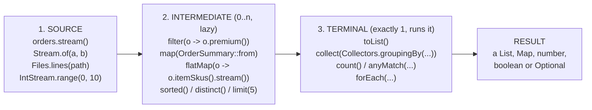
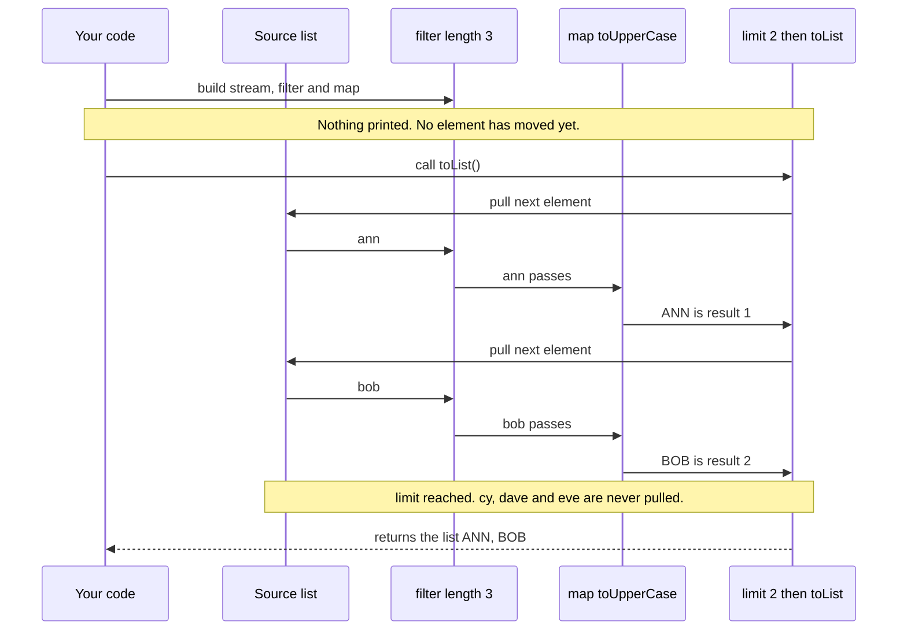

# Topic 3 - The Stream API

You already know lambdas (Topic 1) and the functional interfaces `Function`, `Predicate`,
`Consumer`, `Supplier` and `BinaryOperator` (Topic 2). Streams are where all of that pays off:
almost every stream operation takes one of those interfaces as its argument.

---

## 1. Why streams exist

Most backend code does the same few things with collections, over and over:
**pick some elements, transform them, sort them, and put the result somewhere**.
Before Java 8 you wrote that by hand every time.

**Task:** from a list of `OrderDto`s, return the DELIVERED orders over 100 as `OrderSummary`
response objects, biggest order first.

### Before (Java 7 style)

```java
List<OrderDto> matching = new ArrayList<>();                 // 1. temporary list
for (OrderDto order : orders) {                              // 2. loop
    if (order.status() == OrderStatus.DELIVERED              // 3. if
            && order.totalAmount() > 100) {
        matching.add(order);                                 // 4. add
    }
}
Collections.sort(matching, new Comparator<OrderDto>() {      // 5. sort (anonymous class)
    @Override
    public int compare(OrderDto o1, OrderDto o2) {
        return Double.compare(o2.totalAmount(), o1.totalAmount());
    }
});
List<OrderSummary> result = new ArrayList<>();               // 6. second temporary list
for (OrderDto order : matching) {                            // 7. second loop
    result.add(new OrderSummary(order.id(), order.customerName(), order.totalAmount()));
}
return result;
```

### After (stream pipeline)

```java
return orders.stream()
        .filter(order -> order.status() == OrderStatus.DELIVERED)
        .filter(order -> order.totalAmount() > 100)
        .sorted(Comparator.comparingDouble(OrderDto::totalAmount).reversed())
        .map(OrderSummary::from)
        .toList();
```

Both versions return the same list with the sample data in this module (orders 8, 1, 6, 3 -
checked by running them side by side). What changed:

| Loop version | Stream version |
|---|---|
| You say **how** to do it: create lists, loop, test, add | You say **what** you want: filter, sort, map, collect |
| Temporary mutable lists that can be misused | No temporary lists, nothing to mutate |
| The business rule is hidden between the plumbing | Each line is one business rule, read top to bottom |
| Adding a step (e.g. "only premium") means editing the loop body | Adding a step means adding one line |

Streams do not make impossible things possible. They make common things **shorter, easier to
read and harder to get wrong**.

---

## 2. What a stream is - and is not

Before any syntax, get the mental model right. A stream is a **pipeline that elements flow
through**, not a container of elements.

| A stream... | What it means for you |
|---|---|
| **is not a data structure** | It does not store elements. It pulls them from a source (a list, a file, a generator) when asked. |
| **does not modify its source** | `names.stream().map(String::toUpperCase).toList()` gives a NEW list. `names` is unchanged. |
| **is single-use** | After a terminal operation it is consumed. Using it again throws `IllegalStateException` with the message `stream has already been operated upon or closed`. Get a fresh stream from the source instead. |
| **is lazy** | Intermediate operations (`filter`, `map`, ...) only describe the work. Nothing runs until a terminal operation (`toList`, `count`, ...) is called. |
| **can be infinite** | `Stream.iterate(1, x -> x * 2)` never ends by itself. Laziness plus `limit(n)` makes this usable. |

See `Example01_WhatAStreamIsNot` - the exception message above is copied from its real output.

---

## 3. Where streams come from (sources)

| Source | Example | Notes |
|---|---|---|
| Any `Collection` | `orders.stream()` | The everyday case in backend code |
| Fixed values | `Stream.of("a", "b", "c")` | Also accepts an array (varargs) |
| An array | `Arrays.stream(new int[]{7, 3, 9})` | Gives an `IntStream` for `int[]` |
| A number range | `IntStream.range(1, 5)` -> 1, 2, 3, 4 <br> `IntStream.rangeClosed(1, 5)` -> 1 .. 5 | `range` excludes the end, `rangeClosed` includes it |
| Lines of a file | `Files.lines(path)` | **Must be closed** (see below) |
| A rule (infinite) | `Stream.iterate(1, x -> x * 2).limit(6)` -> 1, 2, 4, 8, 16, 32 | Always add `limit` |
| A rule with a stop condition (Java 9) | `Stream.iterate(10, x -> x > 0, x -> x - 3)` -> 10, 7, 4, 1 | Works like a `for` loop |
| A `Supplier` (infinite) | `Stream.generate(() -> random.nextInt(100)).limit(3)` | Always add `limit` |
| Nothing | `Stream.empty()` | A "no results" value instead of `null` |

### `Files.lines` does not close itself

`Files.lines` reads lazily and keeps the file **open** until the stream is closed. Finishing the
terminal operation does **not** close it. Always use try-with-resources (a `Stream` is `AutoCloseable`):

```java
try (Stream<String> lines = Files.lines(logFile)) {
    long errors = lines.filter(line -> line.startsWith("ERROR")).count();
}   // file is closed here, even if an exception was thrown
```

See `Example02_CreatingStreams` and `Example03_FilesLines`.

---

## 4. The shape of every pipeline

Every stream pipeline has three stages: **one source, zero or more intermediate operations,
exactly one terminal operation**.



---

## 5. Intermediate vs terminal operations

**Intermediate** operations return a new `Stream`, so you can chain them. They are lazy.
**Terminal** operations return something that is *not* a stream (or `void`) and trigger the work.
After the terminal operation the stream is used up.

### Intermediate operations

| Operation | Returns | What it does | Tiny example |
|---|---|---|---|
| `filter(Predicate)` | `Stream<T>` | Keeps elements that pass the test | `.filter(p -> p.inStock())` |
| `map(Function)` | `Stream<R>` | Turns each element into exactly one other element (type may change) | `.map(Product::name)` |
| `flatMap(Function)` | `Stream<R>` | Turns each element into a *stream* of elements and joins them all | `.flatMap(a -> a.tags().stream())` |
| `sorted()` / `sorted(Comparator)` | `Stream<T>` | Sorts (natural order or by comparator). **Stateful** | `.sorted(comparingDouble(Product::price))` |
| `distinct()` | `Stream<T>` | Removes duplicates (uses `equals`), keeps first occurrence. **Stateful** | `.distinct()` |
| `limit(n)` | `Stream<T>` | Keeps at most the first n elements. Short-circuits | `.limit(3)` |
| `skip(n)` | `Stream<T>` | Throws away the first n elements | `.skip(10)` |

**Stateful** means the operation must remember elements it has already seen: `sorted` cannot emit
anything until it has seen *every* element, `distinct` keeps a set of everything seen so far.
`filter` and `map` are stateless: they look at one element at a time. This matters for
performance on big streams and is why `sorted` on an infinite stream never finishes.

### Terminal operations

| Operation | Returns | What it does | Tiny example |
|---|---|---|---|
| `collect(Collector)` | whatever the collector builds | Builds a List, Set, Map, String... | `.collect(Collectors.groupingBy(Product::category))` |
| `toList()` (Java 16) | `List<T>` (unmodifiable) | Shortcut for collecting to a list | `.toList()` |
| `reduce(identity, BinaryOperator)` | `T` | Combines all elements into one value | `.reduce(0.0, Double::sum)` |
| `forEach(Consumer)` | `void` | Does something with each element | `.forEach(System.out::println)` |
| `count()` | `long` | Number of elements | `.count()` |
| `anyMatch(Predicate)` | `boolean` | Is at least one element a match? Stops at the first match | `.anyMatch(p -> p.price() > 400)` |
| `allMatch(Predicate)` | `boolean` | Do all elements match? Stops at the first failure. `true` for an empty stream | `.allMatch(Product::inStock)` |
| `noneMatch(Predicate)` | `boolean` | Does no element match? | `.noneMatch(p -> p.price() < 0)` |
| `findFirst()` | `Optional<T>` | The first element, if any | `.findFirst()` |
| `min(Comparator)` / `max(Comparator)` | `Optional<T>` | Smallest / largest element, if any | `.max(comparingDouble(Product::price))` |

`findFirst`, `min` and `max` return `Optional` because the stream might be empty and there would
be nothing to return. That is safer than returning `null`.

About `reduce`: the **identity** is the starting value and also the result for an empty stream.
It must be the value that changes nothing: `0` for addition, `1` for multiplication, `""` for
string concatenation.

See `Example04` to `Example07`.

---

## 6. Laziness: how elements really flow

When you chain `filter` and `map`, Java does **not** filter the whole list first and then map the
whole result. The terminal operation pulls elements through the pipeline **one at a time**, and
short-circuiting operations like `limit` and `anyMatch` stop pulling as soon as they can.



This is the real output of `Example08_Laziness` (list `ann, bob, cy, dave, eve`, filter on
length 3, map to upper case, `limit(2)`; then `anyMatch(n -> n.startsWith("c"))`):

```text
--- 1) build the pipeline, no terminal operation ---
  (nothing printed above: filter and map have not run yet)
--- 2) add limit(2) and a terminal operation ---
  filter ann
  map    ann
  filter bob
  map    bob
  result: [ANN, BOB]
--- 3) anyMatch stops at the first match ---
  checking ann
  checking bob
  checking cy
  found: true
```

Notice: `filter ann` is followed by `map ann`, not by `filter bob`. And `dave` and `eve` never
appear at all. `anyMatch` stopped at `cy`.

---

## 7. Collectors basics

`collect(...)` is the terminal operation that builds a result container. The `Collectors` class
has the common recipes. Examples below use `SampleData.products()`.

### `toList` - two versions

```java
List<String> a = stream.toList();                         // Java 16+: UNMODIFIABLE
List<String> b = stream.collect(Collectors.toList());     // Java 8: no promise about type or mutability
List<String> c = stream.collect(Collectors.toCollection(ArrayList::new)); // explicitly mutable
```

Calling `a.add("c")` throws `UnsupportedOperationException`. Use `toList()` by default (you rarely
need to change a result list); if you must add to it later, use `toCollection(ArrayList::new)`
so the intent is visible. (`Example09_CollectToList`)

### `toMap` - key function, value function, and an optional merge function

```java
Map<String, Double> priceBySku = products.stream()
        .collect(Collectors.toMap(Product::sku, Product::price));    // keys are unique: fine
```

If two elements produce the **same key**, `toMap` throws `IllegalStateException`. Real output
from `Example10_CollectToMap` (category is not unique):

```text
Duplicate key electronics (attempted merging values Mechanical Keyboard and Wireless Mouse)
```

Fix: pass a **merge function** (a `BinaryOperator` from Topic 2) that decides which value wins:

```java
Map<String, Double> maxPriceByCategory = products.stream()
        .collect(Collectors.toMap(Product::category, Product::price, Math::max));
// {electronics=360.0, furniture=480.0, stationery=4.0}
```

Also: `toMap` throws `NullPointerException` if a value is `null`, even though `HashMap` itself
allows null values.

### `groupingBy` - buckets by key, with an optional downstream collector

```java
Map<String, List<Product>> byCategory = products.stream()
        .collect(Collectors.groupingBy(Product::category));

Map<String, Long> countByCategory = products.stream()
        .collect(Collectors.groupingBy(Product::category, Collectors.counting()));
// {electronics=3, furniture=3, stationery=2}

Map<String, List<String>> namesByCategory = products.stream()
        .collect(Collectors.groupingBy(Product::category,
                 Collectors.mapping(Product::name, Collectors.toList())));
```

The second argument (the *downstream* collector) says what each bucket becomes. A key only
appears if at least one element has it: there is no `garden=0` entry. (`Example11_GroupingBy`)

### `joining` - glue strings together

```java
.map(Product::sku).collect(Collectors.joining(","))                          // dk-400,ch-500,lp-800
.map(Product::name).collect(Collectors.joining(", ", "Furniture: ", "."))    // Furniture: Standing Desk, Office Chair, Desk Lamp.
```

Arguments: delimiter, prefix, suffix. Prefix and suffix are added even for an empty stream,
so `joining(", ", "[", "]")` on nothing gives `[]`. Elements must already be `String`s (map
numbers with `String.valueOf` first). (`Example12_Joining`)

---

## 8. End to end: a backend report

A service receives `OrderDto`s from a repository and must return response DTOs and statistics.
From `Example13_EndToEndOrderReport`:

```java
// "GET /orders/delivered": response DTOs, biggest first
List<OrderSummary> delivered = orders.stream()
        .filter(order -> order.status() == OrderStatus.DELIVERED)
        .sorted(Comparator.comparingDouble(OrderDto::totalAmount).reversed())
        .map(OrderSummary::from)
        .toList();

// dashboard: revenue per customer, cancelled orders ignored
Map<String, Double> revenueByCustomer = orders.stream()
        .filter(order -> order.status() != OrderStatus.CANCELLED)
        .collect(Collectors.groupingBy(OrderDto::customerName, TreeMap::new,
                 Collectors.summingDouble(OrderDto::totalAmount)));

// dashboard: orders per status
Map<OrderStatus, Long> perStatus = orders.stream()
        .collect(Collectors.groupingBy(OrderDto::status, TreeMap::new, Collectors.counting()));
```

Real output:

```text
1) delivered, biggest first:
   OrderSummary[orderId=8, customerName=Eva, totalAmount=410.0]
   OrderSummary[orderId=1, customerName=Ann, totalAmount=250.0]
   OrderSummary[orderId=6, customerName=Bo, totalAmount=150.0]
   OrderSummary[orderId=3, customerName=Cy, totalAmount=120.5]
   OrderSummary[orderId=4, customerName=Ann, totalAmount=99.5]
2) revenue per customer: {Ann=349.5, Bo=230.0, Cy=295.75, Dee=60.0, Eva=410.0}
3) orders per status   : {PENDING=1, SHIPPED=2, DELIVERED=5, CANCELLED=1}
4) premium orders: [1, 3, 4, 5, 7, 8]
```

(`TreeMap::new` is only there so keys print in a stable, sorted order. An enum key in a
`TreeMap` sorts in declaration order.)

Exercise 7 asks you to build a bigger version of this report yourself.

---

## 9. Common mistakes

| Mistake | What happens | Do this instead |
|---|---|---|
| **Reusing a stream** (store it in a variable, call two terminal ops) | `IllegalStateException: stream has already been operated upon or closed` | Call `list.stream()` again for each pipeline |
| **Forgetting the terminal operation** (`list.stream().filter(...).map(...);`) | Nothing happens at all. No error, no result | End every pipeline with `toList()`, `collect`, `count`, ... |
| **Side effects: adding to an outside list** inside `map` / `forEach` (`stream.forEach(x -> result.add(x))`) | Works by accident in simple cases, breaks with parallel streams, hides intent | Let the stream build the result: `.toList()` / `.collect(...)` |
| **`toMap` with duplicate keys** | `IllegalStateException: Duplicate key ...` | Use the 3-argument `toMap` with a merge function, or `groupingBy` |
| **Not closing `Files.lines`** | The file handle stays open (leak) | `try (Stream<String> lines = Files.lines(path)) { ... }` |
| **Modifying a `Stream.toList()` result** (`list.add(...)`) | `UnsupportedOperationException` | Use `Collectors.toCollection(ArrayList::new)` if you really need a mutable list |
| **`map` when you need `flatMap`** | You get `List<List<String>>` / `Stream<List<String>>` instead of a flat list | If the function returns a collection, use `flatMap(x -> x.items().stream())` |
| **Infinite stream without `limit`** (`Stream.iterate(1, x -> x + 1).toList()`) | Runs forever (or until `OutOfMemoryError`) | Add `limit(n)`, use the 3-argument `iterate`, or a short-circuiting terminal op |
| **Using `peek` for logic** | `peek` exists for debugging. It may not run for every element (for example when the JDK can compute `count()` without traversing) | Put real logic in `map` / `filter` / the terminal operation |

---

## 10. Exercises

Work in `src/main/java/com/training/streams/exercises`. Each file has a task description,
an example, and a `// Hint:` per method. Shared records and data are in `model/`
(`SampleData` explains which values are deliberate traps). Do not look in `solutions/` until you
have tried.

| # | Class | You practise | Difficulty |
|---|---|---|---|
| 1 | `Exercise1_CreatingStreams` | `IntStream.rangeClosed`, `Stream.iterate` + `limit`, `Stream.of`, `Files.lines` with try-with-resources | Easy |
| 2 | `Exercise2_FilterAndMap` | `filter`, `map`, method references on the `Product` record | Easy |
| 3 | `Exercise3_SortDistinctLimitSkip` | Paging with `distinct`/`sorted`/`skip`/`limit`, top-N, `sorted` + `findFirst` + `Optional.map` | Easy-Medium |
| 4 | `Exercise4_FlatMap` | `flatMap` on articles/tags and orders/order lines, `mapToInt().sum()` | Medium |
| 5 | `Exercise5_TerminalOperations` | `anyMatch`, `allMatch`, `count`, `reduce` with identity, `findFirst`, `max(Comparator)` | Medium |
| 6 | `Exercise6_Collectors` | `toMap` (with merge), `groupingBy` + `mapping` / `counting`, `joining` | Medium-Hard |
| 7 | `Exercise7_OrderReport` | End-to-end: DTOs to response DTOs, grouping, statistics, most popular SKU | Hard |

### Commands

Run these from the project root (the folder with the parent `pom.xml`).

Run all tests of this module (they fail until you implement the exercises - that is expected):

```bash
mvn -q clean test -pl stream-api
```

Run one test class:

```bash
mvn test -pl stream-api -Dtest=Exercise6_CollectorsTest
```

Run an example: easiest is the green Run arrow next to `main()` in your IDE. Or from the terminal, compile first:

```bash
mvn -q compile -pl stream-api
```

```bash
java -cp stream-api/target/classes com.training.streams.examples.Example01_WhatAStreamIsNot
```

Before you implement anything, every test fails with
`UnsupportedOperationException: TODO: Exercise N - methodName`. Your goal: all green.
